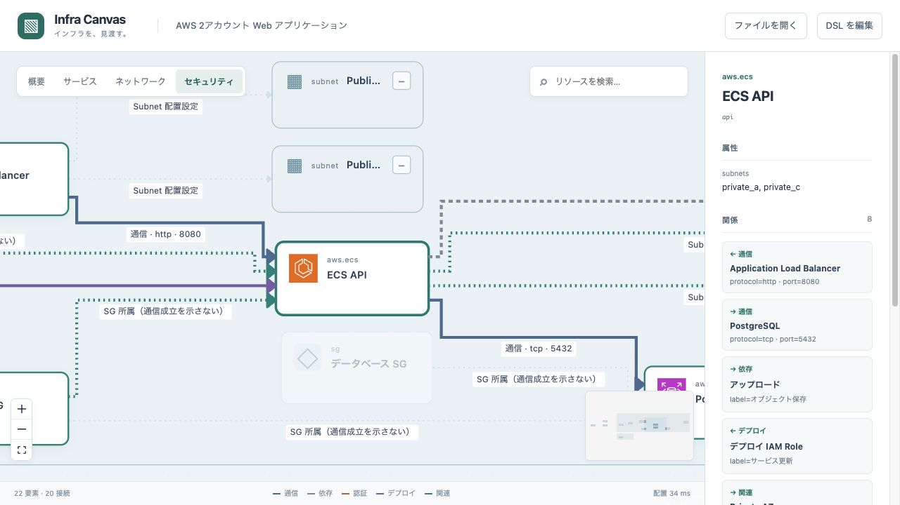
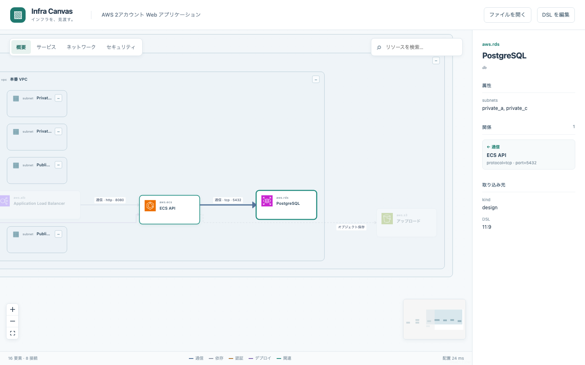
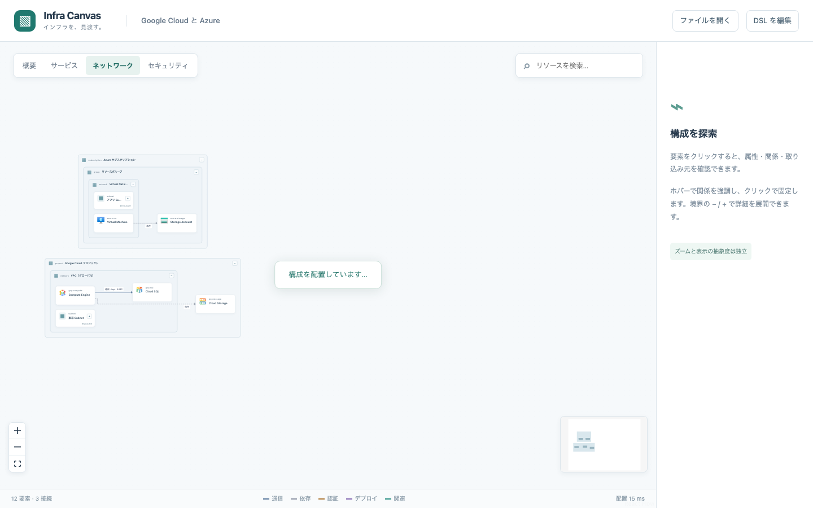
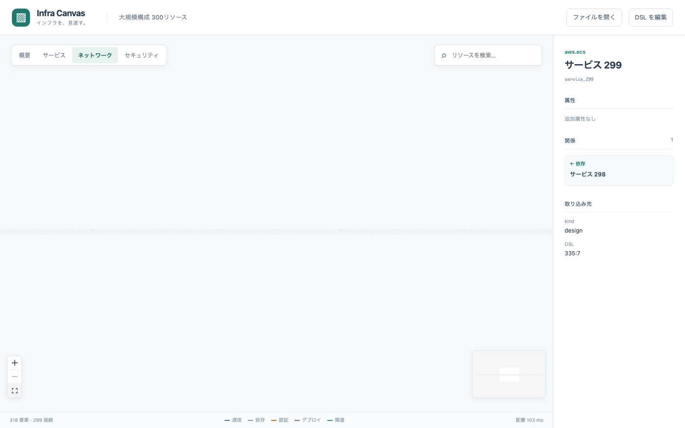

# 初期版の検証記録

2026-10-13 に macOS arm64、Node.js 24.21.0、Chromium、1440 × 900 のブラウザで確認しました。
Codex 内のブラウザでも代表構成の検索・選択・セキュリティ表示を操作しました。

## 自動検証

```bash
npm ci --ignore-scripts
npm run check
mise run lint
npm run test:browser
npm audit
```

型検査、ESLint、Markdown lint、単体テスト56件、ビルド、ブラウザテスト4件が成功しました。
依存パッケージの audit は脆弱性0件でした。ブラウザテスト前に Chromium のインストールが必要です。

回帰テストは構文診断、参照解決、SG の重複所属、表示集約と接続の復元、配置再現性、
外部 JSON の階層検証、Terraform の plan/state 識別、ソース対応、未確定値、機密属性の除外を含みます。
同名 Subnet Group の曖昧性、反復宣言の誤った Public 判定、不正な Git commit 情報も検証します。

ブラウザでは表示切り替え、境界の展開・折りたたみ、検索、関連強調、ドリルダウン、ミニマップ、全体表示、
任意 DSL の反映、エラー時の図の維持、Terraform モデルの取り込み元表示を確認しました。
単一 HTML は `file://` でネットワークを無効にし、検索と表示切り替えが動作し、HTTP 要求が0件でした。
GCP / Azure、複数クラウド、大規模サンプルも実際に読み込んで描画しました。

## Oxlint / Oxfmt への移行検証

2026-10-13 に Oxlint 1.88.0 と Oxfmt 0.73.0 へ移行しました。
ESLint の標準推奨設定と TypeScript 推奨設定から、公式の `@oxlint/migrate` で85ルールを移しました。
未対応の `no-dupe-args` と `no-octal` は、ES module の構文エラーとして拒否されることを確認しました。
`no-undef` と `no-useless-assignment` は nursery ルールですが、従来の検査を維持するため明示的に有効です。

型検査と markdownlint は継続し、`npm run check` と `mise run lint` に Oxfmt の整形チェックを追加しました。
未定義変数、未使用変数、明示的な any、未整形コードの不正入力で検査が失敗することも確認しました。
クリーンインストール後の型検査・Oxlint・markdownlint・整形チェック・56件の単体テスト・ビルド・4件のブラウザテストは成功しました。
依存監査は脆弱性0件です。従来の bundle サイズと client directive に関する警告は継続しています。

整形はコード、CSS、設定、文書を対象にし、独自 DSL と Terraform サンプル、公式 SVG・manifest、lockfile、生成物を除外します。
サンプルを含む Markdown のコードブロックの自動整形も無効です。

## CI の処理時間と並列化

2026-10-14 に PR #6 の実行ログを確認しました。両ワークフローは同時開始しています。

| 対象                                                                                | 実行開始から完了まで | ブラウザーテスト | Chromium 準備 | 型検査からビルド |
| ----------------------------------------------------------------------------------- | -------------------: | ---------------: | ------------: | ---------------: |
| [CI #26](https://github.com/tqer39/infra-canvas/actions/runs/38473320377)           |              3分02秒 |        約2分11秒 |        約27秒 |           約13秒 |
| [Update icons #12](https://github.com/tqer39/infra-canvas/actions/runs/38473320303) |              3分42秒 |        約2分44秒 |        約24秒 |           約15秒 |

通常 CI は3つの検証ジョブを依存待ちなしで起動します。
各ジョブが PR の merge-base、push の前後の差分から同じ条件でブラウザー検証の要否を判定します。
シャード1で `check:static` を一度実行し、型検査・lint・単体テスト・アイコン更新処理の回帰テスト・AI ルール同期を維持します。
文書・Renovate 設定・AI ルール・単体テスト・アイコン取得処理だけの変更ではブラウザー検証と準備を省略します。
ソース・同梱資産・サンプル・依存・mise・ビルド・ブラウザーテスト・通常 CI の変更は実行対象です。
未知のファイルと初回 push も検証します。削除・改名では元のパスも判定し、変更判定の失敗は CI を失敗させます。
`workflow-result` は常に実行し、3シャードの全成功だけを許可します。
必要なブラウザー検証の失敗・キャンセルや、検証ジョブ自体のスキップを成功扱いにしません。
ローカルの `npm run check` は静的検証とビルドの両方を含みます。
ブラウザーテストは CI で別ランナーの3シャードに分割し、各ランナーは2ワーカーで実行します。
`fullyParallel` によりテスト単位で分割し、全テストの成功を集約ジョブで確認します。
ローカルでは2ワーカーを使います。共有する HTML と Terraform モデルは
各テスト実行の `globalSetup` で一度だけ生成して書き込み競合を避けます。
architecture・expressions の共有HTMLとCLIのPNG/PDF出力も `globalSetup` に集約し、
`fullyParallel` の各テストで `beforeAll` が繰り返し生成する処理をなくしました。
テスト118件と開発画面・オフラインHTMLの両方の検証範囲は維持します。
CI では headless shell のみをダウンロードします。
通常 CI の準備は導入済みgit・miseを直接使い、Action取得の待ちや429制限を避けます。
取得先・対象SHA・作業領域の検証、古い生成物の削除と取得後に認証情報が残らないことを回帰テストで確認します。
共有ホストで確認した `ERR_NETWORK_CHANGED` は初期ロードだけ一度読み直し、
一般の読み込みエラーや再発を失敗にする条件も回帰テストで確認します。

最新版のアイコン取得は月次・手動の `Update icons` だけで行い、PR では実行しません。
更新処理自体は通常 CI のネットワークを使わない回帰テストで検証します。
アイコン更新で差分がない場合は、取得元・SVG・ハッシュの検証だけを行い、
通常 CI と重複する依存インストール・全検証・ビルド・ブラウザーテストを省きます。
差分がある場合は、更新後のアイコンに対する全検証を継続します。
PR の古い実行は同じ PR の新しい実行でキャンセルします。
月次・手動のアイコン更新は同時実行せず、実行中の公開処理をキャンセルしません。

## 配置時間

現在の配置版は `infra-canvas-layout-11` です。カードのアイコン・展開ボタンの幅と、
折りたたみ境界の長い名前の折り返しを配置寸法に含めました。
以下は変更前の版での計測記録であり、現行版の性能値ではありません。

ビルド済みライブラリを Node.js で読み込み、各入力の security 表示を1回ずつ計測しました。
版は `infra-canvas-layout-2`、方向は RIGHT、ELK seed は1です。

| 入力         | 構成要素 | 表示要素 | 接続 | 配置時間 |
| ------------ | -------: | -------: | ---: | -------: |
| AWS          |       22 |       22 |   20 |  76.9 ms |
| GCP / Azure  |       12 |       12 |    5 |  12.5 ms |
| 複数クラウド |       13 |       13 |   10 |  12.2 ms |
| 大規模       |      318 |      318 |  299 |  83.7 ms |

大規模入力は300サービスと18境界です。ブラウザで末尾の `service_299` を検索し、選択と全体表示を確認しました。
上記は配置計算のみの単発計測です。描画・読み込み時間、操作の FPS、他環境での性能保証を意味しません。
全要素を同時描画するため、さらに大規模な入力では負荷を計測してから最適化が必要です。
全体表示ではラベルが小さくなるため、検索・ズーム・ドリルダウンを併用してください。

## スクリーンショット

AWS のサービスを検索し、通信と重複 SG の関係を強調した画面です。



オフライン HTML の検索結果です。



GCP / Azure と大規模入力の全体表示です。





## 制約と次の改善

Terraform の実認証や apply は必要ありません。取り込みテストは合成リポジトリと show JSON を使います。
実環境の機密 state を保存する検証は行っていません。
静的 HCL は literal と直接参照のみ対応し、動的な実体は plan JSON が必要です。
未知の所属は未解決として残し、参照から通信や別アカウントを推定しません。

ビルドには約1.9 MBの JavaScript が含まれ、Vite の chunk サイズ警告が出ます。
単一 HTML で ELK・React・アイコンを含める方針によるものです。
React Flow の `use client` 指示に関する警告も出ますが、初期版はクライアント専用で、SSR は行いません。

線のラベル衝突回避・交差表示とIDに基づく配置保存・固定を追加しました。
残る改善は、実リポジトリによるAWSアダプターの対応拡張、曲線の混雑の改善、
固定配置を含む大規模入力の描画時間と操作性能の計測です。

## 詳細表現の追加検証

2026-10-14に、表示レイヤーと保存ビュー、順序付き往復経路、階層を跨ぐ囲み、
配置保存・固定と直角線の整理、接続口・冗長化の表現を検証しました。
`npm run check`、`mise run lint`、`npm run test:browser` が成功しました。
単体テスト113件、アイコン更新テスト9件、ブラウザテスト40件が成功しています。

追加した20件の単体テストで、DSL/JSON往復、複合フィルター、経路の連続性、
折りたたみと接続口の復元、囲みの包含、固定座標と親寸法、経路の障害物回避、
並行線・ラベルの分離、交差表示、不正入力と配置APIの座標検証を確認しました。
追加した4件のブラウザテストで、開発画面とオフラインHTMLのフィルター・ビュー保存、
経路一覧、囲み、接続口、冗長化、配置の移動・DSLダウンロード・再読込、表示粒度の保存を確認しました。
生成例は `artifacts/architecture.html`、画面は `artifacts/architecture.png` です。

矩形の囲みに非メンバーが入る場合、未固定ノードの配置の変化、
曲線の障害物・ラベル衝突回避、接続口の個別属性、固定した大規模図の性能は残る制約です。
ビルド時のchunkサイズと `use client` の警告は継続しています。
詳細は [インフラ構成図の詳細表現](architecture-expressions.md) を参照してください。

## P2・P3と表示フィードバックの検証

2026-10-14に残るP2・P3の表現を追加しました。AZ・リージョン列、論理サービスと配置実体、
公開範囲・信頼ゾーン、暗号化・認証、注釈、根拠・変更予定、台数・集合、任意境界と表示プリセット、
SVG・PNG・PDF出力を [expressions.infra](../examples/expressions.infra) で検証しています。

信頼境界ラベルの位置とコントラスト、曲線の線・ラベルがカードへのクリックを遮るケース、
AWSアカウントのアイコン指定・保存・折りたたみ表示も修正・回帰検証しました。
実際のCodex内ブラウザでも、AWSアカウント表示とDB Replicaの選択を確認しました。

`npm run check`、`mise run lint`、`npm run test:browser` が成功しています。
単体テスト136件、アイコン更新テスト9件、ブラウザテスト44件が成功しました。
A3横の1ページPDFと、A4横・50%の分割PDF（2ページ）を生成し、PDFのページ情報と画像を確認しました。
ビューアーからのSVG/PNGダウンロード・PDF印刷呼び出しは開発画面とオフラインHTMLで検証しました。

出力には直角経路を使用します。曲線そのものの障害物回避、自由な図形・色・フォント、
実環境からの状態取得・差分判定・到達性検証、接続口ごとの個別属性は残る制約です。
PNGは最大辺32767px・1億画素、分割PDFは200ページまでです。
カード寸法やフォントの差により、SVGの見た目はビューアーの完全な画面コピーとは異なります。

## 2026-10-14: 表示と操作の回帰修正

保存ビューに `label` を追加し、サンプルのタブへ日本語の表示名を付けました。
矢印の直線・曲線を1クリックのトグルに戻し、曲線もカードを避けた経路の角を丸めます。
追加の囲みは通常非表示にし、表示切り替えで位置・ズームを保持します。
境界選択では配下のカードと内部接続を強調し、ツールバーと図の領域を分けました。
配置移動モードは操作案内と終了ボタンを表示します。

AZ整列は通信方向RIGHTで縦、DOWNで横に並べます。共有実体はRIGHTでAZ群の右へ配置します。
固定座標を優先し、手動で移動した表示中モデルも固定位置を保持してプレビューを更新しました。

`npm run check` の単体137件・アイコン更新9件と、全ブラウザー45件が成功しました。
曲線の経路をSVG上でサンプリングし、間にある非接続カードを横切らないことを検証しました。
保存ビューの表示名のDSL/JSON往復、境界選択の子カード・内部線、トグルと囲みの視点維持も回帰条件です。
自由なベジェ曲線の制御点編集は未対応で、静的出力は引き続き直角経路です。

## 2026-10-14: 曲線切り替えの描画修正

角を小さく丸めるだけだった曲線表示を、端点間のベジェ曲線へ戻しました。
一直線の端点でも膨らみを付け、カードを横切る場合は曲がり方や迂回経路を変えます。
ラベルの位置は保持し、曲線上へ引き出し線を付けます。

単体141件・アイコン更新9件・全ブラウザー46件が成功しました。
SVG経路の中央が直線から離れることと、トグルで元の経路へ戻ることを回帰条件に追加しました。
非接続カードを横切らない検証と、並行通信が異なる曲線になる検証も成功しています。
静的出力は直角経路です。障害物が多い場合は、角を丸めた迂回経路を使用します。

## ブラウザーLLM・リポジトリ・Subnet/SG

`tests/assistant.test.ts` でSubnet所属、複数SG、ルール検証、DSL往復、候補検証、
GitHub URL制約、commit固定、対象ファイル選択、トークンを含まないモデル入力を確認します。
`tests/browser/assistant.spec.ts` はLLM応答を置き換えて候補表示・明示反映・不正応答時の保持・
古い候補の拒否・リポジトリ内DSLの読み込みを確認します。実モデルの生成品質を保証するテストではありません。
別の作業が既定ポートを使用している場合は `INFRA_TEST_PORT=5193 npm run test:browser` のように指定できます。

実ブラウザーではQwen Coder 3Bによる自然言語からのSubnet・EC2・SG生成と反映を確認しました。
リポジトリ全体を直接モデルに推定させる試行では、不正なDSLや無関係なAWS構成が生成されました。
そのため初期概要はTerraform/Wrangler宣言から構築し、モデルによる補足は候補の確認を必要とします。
